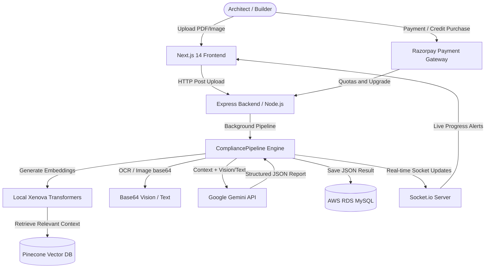

# NYC PermitIQ: Complete System Documentation

Welcome to the comprehensive technical documentation for **PermitIQ by Aureon (NYC Building Code Compliance Analyzer)**, hosted at [nyccodes.permitiq.live](https://nyccodes.permitiq.live).

PermitIQ by Aureon is an enterprise-grade, AI-powered compliance-checking platform designed to automate the review of architectural plans against the dense and complex **New York City Building Codes**. Using an advanced Retrieval-Augmented Generation (RAG) architecture, local neural embeddings, multi-model Google Gemini APIs, and real-time WebSockets, PermitIQ by Aureon analyzes uploaded plans (PDFs or drawings) and produces standard compliance reviews, issue logs, architectural appreciations, and layout betterments in seconds.

---

## 🗺️ System Architecture Overview

PermitIQ by Aureon follows a decoupled client-server architecture, built for extreme performance, cost efficiency, and high throughput.



---

## 🛠️ Tech Stack & Key Technologies

### 1. Frontend (Client-Side)
*   **Framework**: Next.js 14 (App Router & React) built with TypeScript.
*   **Styling**: Vanilla TailwindCSS with a high-fidelity, polished dark-mode interface (`bg-slate-900` cards, HSL borders, dynamic amber alerts).
*   **Animations**: Framer Motion for premium micro-animations and dynamic transitions.
*   **State Management**: Zustand for global auth, usage tracking, and system state storage.
*   **Report Generation**: `jsPDF` for client-side compilation of PDF compliance certificates.
*   **Real-time Communication**: `socket.io-client` for real-time progress percentages.

### 2. Backend (Server-Side)
*   **Runtime Environment**: Node.js v25 with TypeScript.
*   **Application Framework**: Express.js.
*   **Process Manager**: PM2 running on AWS EC2 (`nyc-backend` and `nyc-frontend`).
*   **Upload Processing**: `multer` for secure, multi-part form-data parsing (10MB limit).
*   **Real-time Services**: `Socket.io` server integration.

### 3. AI & RAG Infrastructure
*   **Vector Database**: Pinecone Serverless (Index: `nyc-code-compliance`). Holds indexes of **113 specialized NYC Building Code documents**.
*   **Local Embeddings**: `@xenova/transformers` executing the `Xenova/all-MiniLM-L6-v2` model. Embeddings are generated **locally on the EC2 server**, maintaining a 100% cost-free ingestion pipeline.
*   **LLM API Engine**: Google Generative AI (Gemini Studio API), running high-performance `gemini-2.5-pro` and `gemini-2.5-flash` models.
*   **Database**: AWS RDS MySQL (Stockholm `eu-north-1` region) storing structured user accounts, session tokens, and compliance plans.

---

## 📚 NYC Building Code Vector Database (113 Documents Ingested)

The Pinecone index contains evolutionarily indexed paragraphs and tables extracted using a custom `pdfjs-dist` structural parser in the ingest script (`langchain_ingest.ts`). The database maps:
*   **Building Code (BC)**: 57 documents / chapters.
*   **Fuel Gas Code (FGC)**: 15 documents / chapters.
*   **Mechanical Code (MC)**: 18 documents / chapters.
*   **Plumbing Code (PC)**: 18 documents / chapters.
*   **General Administrative Provisions (GAP)**: 5 documents.

---

## 🧠 Advanced Multi-Query RAG & Resilience Engine

To guarantee compliance auditing, the backend does not rely on a single user vector query. Instead, it utilizes a custom **Multi-Query Semantic Aggregator**:

### 1. 15 Targeted Search Vectors
When a plan is analyzed, 15 distinct, domain-specific semantic queries are run in parallel against Pinecone:
1.  **Fire & Life Safety**: Chapters 7 & 9 requirements (detectors, sprinklers, alarms).
2.  **Fire Protection**: Fire department access and standpipe requirements.
3.  **Means of Egress**: Exit doors, travel distances, corridors, exit signs.
4.  **Accessibility**: ADA compliance, wheelchair clearances, ramps, elevators.
5.  **Interior Environment**: Habitable room dimensions, minimum area, ceiling heights.
6.  **Doors & Windows**: Clearance widths, emergency escape heights, sill elevations.
7.  **Stairs & Vertical Transitions**: Risers, treads, guardrails, handrails.
8.  **Structural Design**: Live/dead loads, seismic, wind, bearing capabilities.
9.  **Exterior & Roofing**: Facades, waterproofing, thermal insulation, parapets.
10. **Interior Finishes**: Flame spread indexes, smoke development limits.
11. **Electrical (MEP)**: Panel locations, GFCI circuits, outlet layouts.
12. **Plumbing (MEP)**: Bathroom/kitchen water supply, trap vents, drain lines.
13. **Mechanical (MEP)**: HVAC vents, exhaust fans, air duct configurations.
14. **Zoning & Admin**: Setbacks, floor area ratios (FAR), lot covers.
15. **Architectural Filing**: Stamp, seals, DOB permit classifications.

This multi-query method retrieves up to **600 candidate matches**, deduplicates them, and passes the top **40 unique highly-relevant chapters** directly as high-context grounding.

### 2. Double-Key & Multi-Model Rotation
To prevent quota locks or API failures, the backend supports:
*   **Multi-Key String Parsing**: `GOOGLE_AI_STUDIO_KEY` in `.env` accepts multiple keys separated by commas. The system rotates keys on retry.
*   **Model Alternation**: On subsequent retries, the engine swaps models seamlessly:
    ```ts
    const models = [
      "gemini-2.5-pro",
      "gemini-2.5-flash",
      "gemini-2.5-pro",
      "gemini-2.5-flash"
    ];
    ```

### 3. Rate-Limit Exponential Backoff
If Gemini throws a `429 (Rate Limit Exceeded)`, the backend implements an active sleep cycle backoff:
$$\text{Delay} = \min(5000 \times 2^{\text{retry} - 1}, 40000) \text{ ms}$$
This schedules sleeps of **5s ➔ 10s ➔ 20s ➔ 40s** to guarantee the pipeline does not drop user scans.

### 4. Self-Healing JSON Parser & Repairs
Because architectural analyses output large datasets that can occasionally hit context boundary cutoffs, the engine includes a **JSON repair system**:
*   **Dangling String Closing**: Automatically detects if the output was cut off mid-string, closes the string quotes cleanly, and trims trailing commas.
*   **Brace/Bracket Balancer**: Calculates the difference between opening and closing braces (`{` vs `}`) and brackets (`[` vs `]`) and appends the necessary closing characters to make the JSON structurally sound before parsing.
*   **Smart Issue Unpacker**: If the AI yields a malformed array but returns list indicators in the Markdown summaries, a regex parser automatically rebuilds and inserts individual issue nodes.

---

## 📈 Real-Time Socket Progression Pipeline

A user uploading a plan gets instant visual indicators in the premium UI. The backend uses WebSockets (`Socket.io`) to update the progress bar step-by-step:

| Progress | Event | Action & UI Message |
| :--- | :--- | :--- |
| **10%** | `INITIALIZING` | Initializing Vectorless RAG Agent across 114 NYC models... |
| **20%** | `EXTRACTING_DATA` | Extracting technical data from building plan (PDF parsing/Vision base64 processing)... |
| **40%** | `RETRIEVING_RULES` | Querying NYC Building Code vector database (113 chapters)... |
| **60%** | `AI_ANALYZING` | Senior Plan Examiner is verifying compliance against NYC mandates... |
| **70% - 85%** | `CHECKING_COMPLIANCE` | *(Randomized ticker interval)* Performing cross-document safety verification... |
| **90%** | `GENERATING_REPORT` | Compiling final forensic compliance report... |
| **100%** | `COMPLETE` | Analysis completed successfully! Emits the final `ComplianceResult`. |

---

## 💳 Billing, Monetization & Quota Engine

PermitIQ by Aureon features a premium, secure subscription and credit-purchasing portal integrated with **Razorpay**. 

### 1. Purchase Packs
*   **`pack-1`**: 1 Scan Upload for **$2.00 USD**
*   **`pack-11` / `pack-12`**: 12 Scan Uploads for **$20.00 USD**
*   **`pack-55` / `pack-65`**: 65 Scan Uploads for **$100.00 USD**

### 2. Transaction Integrity & Double-Upgrade Protection
To prevent race conditions, the user table maintains a `lastHandledSessionId` column. 
```sql
UPDATE `user` 
SET lastHandledSessionId = ?, scanLimit = scanLimit + ? 
WHERE id = ? AND (lastHandledSessionId IS NULL OR lastHandledSessionId <> ?)
```
This atomic SQL constraint ensures no user is credited twice if they hit refresh or triggering hooks fire twice.

---

## 🗄️ Database Schema Reference (MySQL)

```sql
-- 1. USER TABLE
CREATE TABLE `user` (
  `id` VARCHAR(36) PRIMARY KEY,
  `name` VARCHAR(255) NOT NULL,
  `email` VARCHAR(255) UNIQUE NOT NULL,
  `password` VARCHAR(255) NOT NULL,
  `subStatus` VARCHAR(50) DEFAULT 'free', -- 'free', 'active'
  `scanLimit` INT DEFAULT 0,              -- Number of allowed uploads
  `lastHandledSessionId` VARCHAR(255),    -- Payment security token
  `createdAt` TIMESTAMP DEFAULT CURRENT_TIMESTAMP
);

-- 2. PLAN TABLE
CREATE TABLE `plan` (
  `id` VARCHAR(36) PRIMARY KEY,
  `userId` VARCHAR(36) NOT NULL,
  `fileName` VARCHAR(255) NOT NULL,
  `fileUrl` VARCHAR(255),
  `status` ENUM('processing', 'analyzed', 'failed') DEFAULT 'processing',
  `analysisResult` JSON DEFAULT NULL,
  `createdAt` TIMESTAMP DEFAULT CURRENT_TIMESTAMP,
  FOREIGN KEY (`userId`) REFERENCES `user`(`id`)
);
```

---

## 🚀 Live Server Deployment & Operations Guide

PermitIQ by Aureon is deployed on an **AWS EC2 server** with live builds managed via Git.

### 1. Server Configuration
*   **Folder Location**: `~/nyc_permitiq.live`
*   **Port Config**: Backend runs on `5000` (reverse-proxied), Frontend runs on Next.js default `3000`.
*   **Process Managers**: Processes are managed via `PM2` for active daemon monitoring and automatic crash recovery.

### 2. Live Shell Commands for Updates (Windows PowerShell Context)
To roll out updates to the live server, access the server terminal and run:

```bash
# 1. Update backend files & rebuild TypeScript
cd ~/nyc_permitiq.live
git pull origin main
cd backend
npm install
npm run build
pm2 restart nyc-backend

# 3. Update frontend files & rebuild Next.js static bundles
cd ~/nyc_permitiq.live/frontend
npm install
npm run build
pm2 restart nyc-frontend

# 4. View logs
pm2 logs nyc-backend
```

---

*This document serves as the absolute single source of truth for the PermitIQ by Aureon workspace architecture, API structure, and data flows.*
